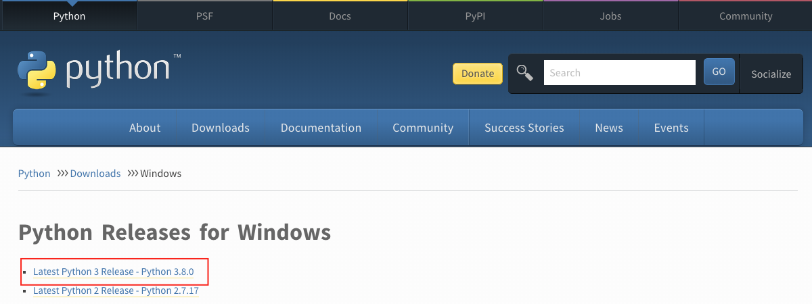
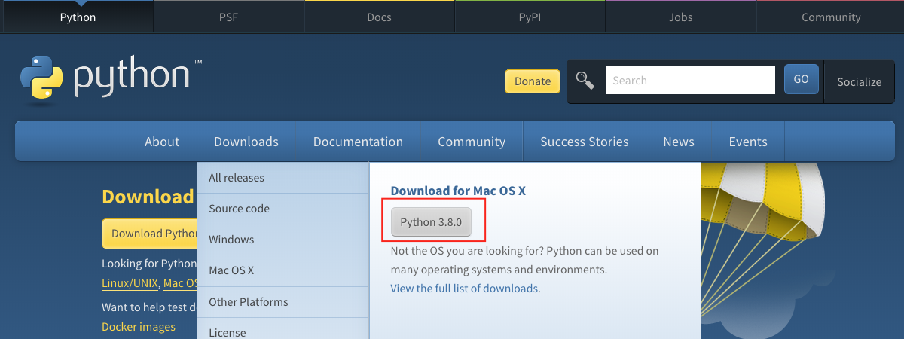
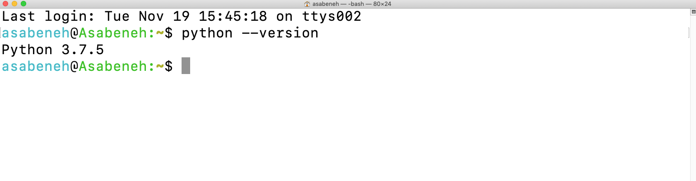
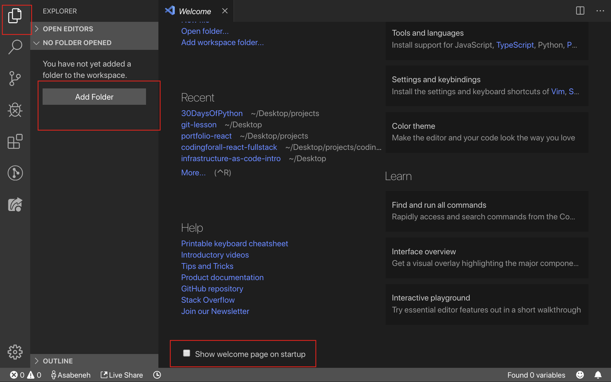
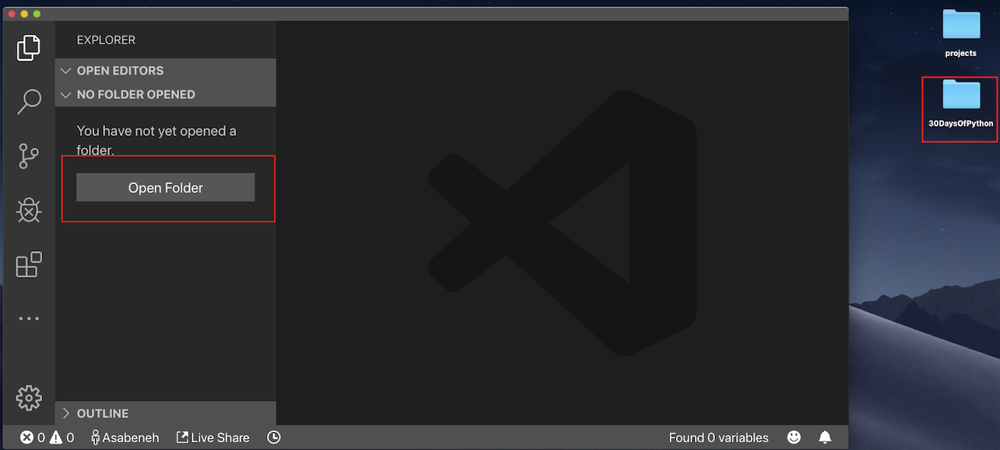
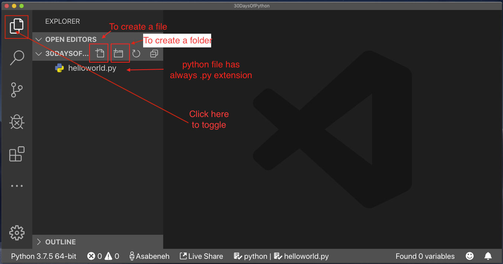
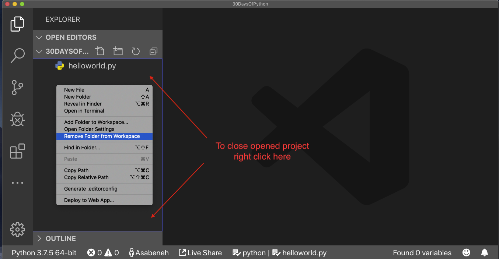
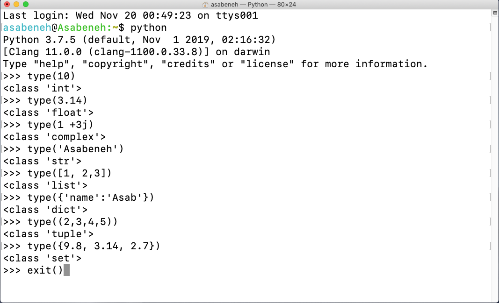

<div align="center">
  <h1> 30 Days Of Python: دن 1 - تعارف</h1>

  <sub>ترجمہ و ترتیب:
  <a href="https://github.com/MuhammadIshaqDev" target="_blank">محمد اسحاق (Muhammad Ishaq)</a><br>
  <small> دوسرا ایڈیشن: جولائی، 2021 | اردو ترجمہ</small>
  </sub>
</div>

[دن 2 >>](./02_variables_builtin_functions.md)


- [🐍 پائتھن کے 30 دن](#-پائتھن-کے-30-دن)
    - [🙌 اسپانسر بنیں](#-اسپانسر-بنیں)
- [📘 دن 1](#-دن-1)
  - [خوش آمدید](#خوش-آمدید)
  - [تعارف](#تعارف)
  - [پائتھن کیوں؟](#پائتھن-کیوں)
  - [ماحول کی ترتیب (Environment Setup)](#ماحول-کی-ترتیب-environment-setup)
    - [پائتھون انسٹال کرنا](#پائتھون-انسٹال-کرنا)
    - [پائتھن شیل (Python Shell)](#پائتھن-شیل-python-shell)
    - [ویژول اسٹوڈیو کوڈ انسٹال کرنا](#ویژول-اسٹوڈیو-کوڈ-انسٹال-کرنا)
      - [ویژول اسٹوڈیو کوڈ کو کیسے استعمال کریں](#ویژول-اسٹوڈیو-کوڈ-کو-کیسے-استعمال-کریں)
  - [بنیادی پائتھون (Basic Python)](#بنیادی-پائتھون-basic-python)
    - [پائتھون نحو (Python Syntax)](#پائتھون-نحو-python-syntax)
    - [پائتھون انڈینٹیشن (Python Indentation)](#پائتھون-انڈینٹیشن-python-indentation)
    - [تبصرے (Comments)](#تبصرے-comments)
    - [ڈیٹا کی اقسام (Data types)](#ڈیٹا-کی-اقسام-data-types)
      - [نمبر (Number)](#نمبر-number)
      - [اسٹرنگ (String)](#اسٹرنگ-string)
      - [بولینز (Booleans)](#بولینز-booleans)
      - [لسٹ (List)](#لسٹ-list)
      - [ڈکشنری (Dictionary)](#ڈکشنری-dictionary)
      - [ٹپل (Tuple)](#ٹپل-tuple)
      - [سیٹ (Set)](#سیٹ-set)
    - [ڈیٹا کی اقسام چیک کرنا (Checking Data types)](#ڈیٹا-کی-اقسام-چیک-کرنا-checking-data-types)
    - [پائتھون فائل (Python File)](#پائتھون-فائل-python-file)
  - [💻 مشقیں - دن 1](#-مشقیں---دن-1)
    - [مشق: لیول 1](#مشق-لیول-1)
    - [مشق: لیول 2](#مشق-لیول-2)
    - [مشق: لیول 3](#مشق-لیول-3)

# 📘 دن 1

## خوش آمدید

**مبارک ہو** کہ آپ نے _30 دن پائتھون (30 days of Python)_ پروگرامنگ چیلنج میں حصہ لینے کا فیصلہ کیا ہے۔ اس چیلنج میں، آپ پائتھون پروگرامر بننے کے لیے درکار ہر چیز اور پروگرامنگ کا پورا تصور سیکھیں گے۔ چیلنج کے آخر میں آپ کو ایک _30DaysOfPython_ پروگرامنگ چیلنج کا سرٹیفکیٹ ملے گا۔

اگر آپ چیلنج میں فعال طور پر حصہ لینا چاہتے ہیں، تو آپ [30DaysOfPython چیلنج](https://t.me/ThirtyDaysOfPython) ٹیلیگرام گروپ میں شامل ہو سکتے ہیں۔

## تعارف

پائتھون عام مقصد کی پروگرامنگ کے لیے ایک ہائی لیول پروگرامنگ لینگویج ہے۔ یہ ایک اوپن سورس، انٹرپریٹڈ، آبجیکٹ اورینٹڈ پروگرامنگ لینگویج ہے۔ پائتھون کو ایک ڈچ پروگرامر، گائیڈو وان روسم (Guido van Rossum) نے تخلیق کیا تھا۔ پائتھون پروگرامنگ لینگویج کا نام ایک برطانوی اسکیچ کامیڈی سیریز، *مانٹی پائتھنز فلائنگ سرکس (Monty Python's Flying Circus)* سے ماخوذ ہے۔ اس کا پہلا ورژن 20 فروری 1991 کو جاری کیا گیا۔ پائتھون کا یہ 30 دن کا چیلنج آپ کو پائتھون کے تازہ ترین ورژن، پائتھون 3، کو قدم بہ قدم سیکھنے میں مدد کرے گا۔ موضوعات کو 30 دنوں میں تقسیم کیا گیا ہے، جہاں ہر دن میں سمجھنے میں آسان وضاحتیں، حقیقی دنیا کی مثالیں، اور بہت ساری ہینڈ آن مشقیں اور پروجیکٹس شامل ہیں۔

یہ چیلنج ابتدائی افراد (beginners) اور پیشہ ور افراد کے لیے ڈیزائن کیا گیا ہے جو پائتھون پروگرامنگ لینگویج سیکھنا چاہتے ہیں۔ چیلنج کو مکمل کرنے میں 30 سے ​​100 دن لگ سکتے ہیں۔ جو لوگ ٹیلیگرام گروپ میں بڑھ چڑھ کر حصہ لیتے ہیں ان کے چیلنج کو مکمل کرنے کا امکان بہت زیادہ ہوتا ہے۔

یہ چیلنج پڑھنے میں آسان، بات چیت کی انگریزی میں لکھا گیا (اردو میں ترجمہ شدہ)، دلکش، حوصلہ افزا اور ساتھ ہی انتہائی معلوماتی ہے۔ اس چیلنج کو ختم کرنے کے لیے آپ کو کافی وقت دینے کی ضرورت ہے۔ اگر آپ بصری طور پر سیکھنے والے ہیں، تو آپ <a href="https://www.youtube.com/channel/UC7PNRuno1rzYPb1xLa4yktw"> Washera</a> یوٹیوب چینل پر ویڈیو سبق حاصل کر سکتے ہیں۔ آپ [Python for Absolute Beginners video](https://youtu.be/OCCWZheOesI) سے شروع کر سکتے ہیں۔ چینل کو سبسکرائب کریں، تبصرہ کریں اور یوٹیوب ویڈیوز پر سوالات پوچھیں اور فعال رہیں۔

## پائتھون کیوں؟

یہ ایک ایسی پروگرامنگ لینگویج ہے جو انسانی زبان کے بہت قریب ہے اور اسی وجہ سے، اسے سیکھنا اور استعمال کرنا آسان ہے۔ پائتھون مختلف صنعتوں اور کمپنیوں (بشمول گوگل) کے ذریعہ استعمال ہوتی ہے۔ یہ ویب ایپلی کیشنز، ڈیسک ٹاپ ایپلی کیشنز، سسٹم ایڈمنسٹریشن، اور مشین لرننگ لائبریریوں کو تیار کرنے کے لیے استعمال ہوتی رہی ہے۔ پائتھون ڈیٹا سائنس اور مشین لرننگ کمیونٹی میں ایک انتہائی پسندیدہ زبان ہے۔ مجھے امید ہے کہ پائتھون سیکھنا شروع کرنے کے لیے یہ کافی ہے۔

## ماحول کی ترتیب (Environment Setup)

### پائتھون انسٹال کرنا

پائتھون اسکرپٹ چلانے کے لیے آپ کو پائتھون انسٹال کرنے کی ضرورت ہے۔ آئیے پائتھون [ڈاؤن لوڈ](https://www.python.org/) کریں۔
اگر آپ ونڈوز کے صارف ہیں، تو سرخ دائرے والے بٹن پر کلک کریں۔

[](https://www.python.org/)

اگر آپ macOS کے صارف ہیں، تو سرخ دائرے والے بٹن پر کلک کریں۔

[](https://www.python.org/)

یہ چیک کرنے کے لیے کہ آیا پائتھون انسٹال ہے، اپنے ڈیوائس کے ٹرمینل پر درج ذیل کمانڈ لکھیں۔

```shell
python3 --version
```



جیسا کہ آپ ٹرمینل سے دیکھ سکتے ہیں، میں اس وقت _Python 3.7.5_ ورژن استعمال کر رہا ہوں۔ آپ کا پائتھون کا ورژن مجھ سے مختلف ہو سکتا ہے لیکن یہ 3.6 یا اس سے اوپر ہونا چاہیے۔ اگر آپ پائتھون کا ورژن دیکھنے میں کامیاب ہو گئے ہیں، تو بہت اچھے! آپ کی مشین پر پائتھون انسٹال ہو چکا ہے۔ اگلے حصے پر جاری رکھیں۔

### پائتھون شیل (Python Shell)

پائتھون ایک انٹرپریٹڈ اسکرپٹنگ لینگویج ہے، اس لیے اسے کمپائل کرنے کی ضرورت نہیں ہے۔ اس کا مطلب ہے کہ یہ کوڈ کو لائن بہ لائن چلاتا ہے۔ پائتھون ایک _پائتھون شیل (Python Interactive Shell)_ کے ساتھ آتا ہے۔ یہ ایک پائتھون کمانڈ کو چلانے اور نتیجہ حاصل کرنے کے لیے استعمال ہوتا ہے۔

پائتھون شیل صارف سے پائتھون کوڈ کا انتظار کرتا ہے۔ جب آپ کوڈ درج کرتے ہیں، تو یہ کوڈ کی ترجمانی کرتا ہے اور اگلی سطر میں نتیجہ دکھاتا ہے۔
اپنا ٹرمینل یا کمانڈ پرامپٹ (cmd) کھولیں اور لکھیں:

```shell
python
```


پائتھون انٹرایکٹو شیل کھل گیا ہے اور یہ آپ کے پائتھون کوڈ (پائتھون اسکرپٹ) لکھنے کا انتظار کر رہا ہے۔ آپ اس علامت >>> کے آگے اپنا پائتھون اسکرپٹ لکھیں گے اور پھر Enter پر کلک کریں گے۔
آئیے پائتھون اسکرپٹنگ شیل پر اپنا پہلا اسکرپٹ لکھیں۔


بہت اچھے، آپ نے پائتھون انٹرایکٹو شیل پر اپنا پہلا پائتھون اسکرپٹ لکھا۔ ہم پائتھون انٹرایکٹو شیل کو کیسے بند کرتے ہیں؟
شیل کو بند کرنے کے لیے، اس علامت >>> کے آگے **exit()** کمانڈ لکھیں اور Enter دبائیں۔


اب، آپ جانتے ہیں کہ پائتھون انٹرایکٹو شیل کو کیسے کھولنا ہے اور اس سے باہر کیسے نکلنا ہے۔

اگر آپ ایسے اسکرپٹس لکھتے ہیں جو پائتھون سمجھتا ہے تو پائتھون آپ کو نتائج دے گا، اگر نہیں تو یہ غلطیاں (errors) واپس کرتا ہے۔ آئیے جان بوجھ کر غلطی کریں اور دیکھیں کہ پائتھون کیا واپس کرتا ہے۔


جیسا کہ آپ واپس کی گئی خرابی سے دیکھ سکتے ہیں، پائتھون اتنا ذہون ہے کہ وہ جانتا ہے کہ ہم نے کیا غلطی کی تھی جو کہ _Syntax Error: invalid syntax_ تھی۔ پائتھون میں ضرب کے لیے x کا استعمال کرنا نحو کی غلطی ہے کیونکہ (x) پائتھون میں ایک درست نحو نہیں ہے۔ ضرب کے لیے ہم (**x**) کے بجائے ستارہ (*) استعمال کرتے ہیں۔

پروگرام سے غلطیوں کی شناخت اور انہیں دور کرنے کے عمل کو _ڈیبگنگ (debugging)_ کہتے ہیں۔ آئیے **x** کی جگہ * لگا کر اسے ڈیبگ کریں۔


ہمارا بگ ٹھیک ہو گیا، کوڈ چل گیا اور ہمیں وہ نتیجہ مل گیا جس کی ہم توقع کر رہے تھے۔ ایک پروگرامر کے طور پر آپ کو روزانہ کی بنیاد پر اس قسم کی غلطیاں نظر آئیں گی۔ ڈیبگنگ میں اچھا بننے کے لیے آپ کو یہ سمجھنا چاہیے کہ آپ کو کس قسم کی خرابیوں کا سامنا ہے۔ پائتھون کی کچھ غلطیاں جن کا آپ کو سامنا ہو سکتا ہے وہ ہیں _SyntaxError_، _IndexError_، _NameError_، _ModuleNotFoundError_، _KeyError_، _ImportError_، _AttributeError_، _TypeError_، _ValueError_، _ZeroDivisionError_ وغیرہ۔ ہم بعد کے حصوں میں پائتھون کی مختلف **_error types_** کے بارے میں مزید دیکھیں گے۔

آئیے مزید مشق کریں کہ پائتھون انٹرایکٹو شیل کو کیسے استعمال کیا جائے۔ اپنے ٹرمینل یا کمانڈ پرامپٹ پر جائیں اور لفظ **python** لکھیں۔


پائتھون انٹرایکٹو شیل کھل گیا ہے۔ آئیے کچھ بنیادی ریاضی کے عمل کریں (جمع، تفریق، ضرب، تقسیم، ماڈیولس، ایکسپونینٹیشن)۔

آئیے کوئی بھی پائتھون کوڈ لکھنے سے پہلے کچھ ریاضی کریں:

- 2 + 3 = 5
- 3 - 2 = 1
- 3 \* 2 = 6
- 3 / 2 = 1.5
- 3 \*\* 2 = 3 x 3 = 9

پائتھون میں، ہمارے پاس درج ذیل اضافی عمل ہیں:

- 3 % 2 = 1 => جس کا مطلب ہے باقی (remainder) تلاش کرنا
- 3 // 2 = 1 => جس کا مطلب ہے باقی کو ہٹانا (floor division)

آئیے مندرجہ بالا ریاضی کے تاثرات کو پائتھون کوڈ میں تبدیل کریں۔ پائتھون شیل کھول دیا گیا ہے اور آئیے شیل کے بالکل آغاز میں ایک تبصرہ (comment) لکھیں۔

ایک _تبصرہ (comment)_ کوڈ کا ایک حصہ ہے جو پائتھون کے ذریعہ نہیں چلایا جاتا ہے۔ لہذا ہم اپنے کوڈ کو مزید پڑھنے کے قابل بنانے کے لیے اپنے کوڈ میں کچھ متن چھوڑ سکتے ہیں۔ پائتھون تبصرے کے حصے کو نہیں چلاتا ہے۔ پائتھون میں ایک تبصرہ ہیش (#) علامت سے شروع ہوتا ہے۔
آپ پائتھون میں اس طرح تبصرہ لکھتے ہیں:

```shell
 # تبصرہ ہیش سے شروع ہوتا ہے
 # یہ ایک پائتھون تبصرہ ہے، کیونکہ یہ (#) علامت سے شروع ہوتا ہے
```


اگلے حصے کی طرف بڑھنے سے پہلے، آئیے پائتھون انٹرایکٹو شیل پر مزید مشق کریں۔ شیل پر _exit()_ لکھ کر کھولے ہوئے شیل کو بند کریں اور اسے دوبارہ کھولیں اور آئیے مشق کریں کہ پائتھون شیل پر متن (text) کیسے لکھا جائے۔


### ویژول اسٹوڈیو کوڈ انسٹال کرنا (Installing Visual Studio Code)

پائتھون انٹرایکٹو شیل چھوٹے اسکرپٹ کوڈز کو آزمانے اور جانچنے کے لیے اچھا ہے لیکن یہ کسی بڑے پروجیکٹ کے لیے نہیں ہوگا۔ حقیقی کام کے ماحول میں، ڈویلپرز کوڈ لکھنے کے لیے مختلف کوڈ ایڈیٹرز کا استعمال کرتے ہیں۔ اس 30 دن کے پائتھون پروگرامنگ چیلنج میں، ہم ویژول اسٹوڈیو کوڈ (Visual Studio Code) استعمال کریں گے۔ ویژول اسٹوڈیو کوڈ ایک بہت مقبول اوپن سورس ٹیکسٹ ایڈیٹر ہے۔ میں وی ایس کوڈ (vscode) کا مداح ہوں اور میں [ڈاؤن لوڈ](https://code.visualstudio.com/) کرنے کی سفارش کروں گا، لیکن اگر آپ دوسرے ایڈیٹرز کے حق میں ہیں، تو آپ کے پاس جو ہے اس کے ساتھ بلا جھجھک عمل کریں۔

[](https://code.visualstudio.com/)

اگر آپ نے ویژول اسٹوڈیو کوڈ انسٹال کر لیا ہے، تو آئیے دیکھتے ہیں کہ اسے کیسے استعمال کیا جائے۔
اگر آپ کو ویڈیو پسند ہے، تو آپ یہ Visual Studio Code for Python [Video tutorial](https://www.youtube.com/watch?v=bn7Cx4z-vSo) دیکھ سکتے ہیں۔

#### ویژول اسٹوڈیو کوڈ کو کیسے استعمال کریں

ویژول اسٹوڈیو آئیکن پر ڈبل کلک کرکے ویژول اسٹوڈیو کوڈ کھولیں۔ جب آپ اسے کھولیں گے تو آپ کو اس قسم کا انٹرفیس ملے گا۔ لیبل والے آئیکنز کے ساتھ بات چیت کرنے کی کوشش کریں۔



اپنے ڈیسک ٹاپ پر `30DaysOfPython` کے نام سے ایک فولڈر بنائیں۔ پھر ویژول اسٹوڈیو کوڈ کا استعمال کرتے ہوئے اسے کھولیں۔

[]

[]

اسے کھولنے کے بعد، آپ کو 30DaysOfPython پروجیکٹ کی ڈائرکٹری کے اندر فائلیں اور فولڈرز بنانے کے شارٹ کٹس نظر آئेंगे۔ جیسا کہ آپ نیچے دیکھ سکتے ہیں، میں نے پہلی فائل `helloworld.py` بنا دی ہے۔ آپ بھی ایسا ہی کر سکتے ہیں۔



کوڈنگ کے طویل دن کے بعد، آپ اپنے کوڈ ایڈیٹر کو بند کرنا چاہتے ہیں، ہے نا؟ اس طرح آپ کھلے ہوئے پروجیکٹ کو بند کریں گے۔

[]

مبارک ہو، آپ نے ترقیاتی ماحول (development environment) کی ترتیب مکمل کر لیا ہے۔ آئیے کوڈنگ شروع کریں۔

## بنیادی پائتھون (Basic Python)

### پائتھون نحو (Python Syntax)

ایک پائتھون اسکرپٹ پائتھون انٹرایکٹو شیل میں یا کوڈ ایڈیٹر میں لکھی جا سکتی ہے۔ پائتھون فائل کی ایکسٹینشن .py ہوتی ہے۔

### پائتھون انڈینٹیشن (Python Indentation)

انڈینٹیشن متن میں سفید جگہ (white space) ہے۔ بہت سی زبانوں میں کوڈ کی پڑھنے کی صلاحیت کو بڑھانے کے لیے انڈینٹیشن کا استعمال کیا جاتا ہے۔ تاہم، پائتھون کوڈ کے بلاکس بنانے کے لیے انڈینٹیشن کا استعمال کرتا ہے۔ دوسری پروگرامنگ زبانوں میں، انڈینٹیشن کے بجائے کوڈ بلاکس بنانے کے لیے کرلی بریکٹ (curly brackets) استعمال کیے جاتے ہیں۔ پائتھون کوڈ لکھتے وقت عام خامیوں میں سے ایک غلط انڈینٹیشن ہے۔


### تبصرے (Comments)

تبصرے کوڈ کی پڑھنے کی صلاحیت کو بڑھانے اور ڈویلپرز کو اپنے کوڈ میں نوٹس چھوڑنے کی اجازت دینے میں اہم کردار ادا کرتے ہیں۔ پائتھون میں، ہیش (#) علامت سے پہلے کوئی بھی متن ایک تبصرہ سمجھا جاتا ہے اور کوڈ چلنے پر اس پر عمل نہیں ہوتا۔

**مثال: سنگل لائن کمنٹ**

```shell
    # یہ پہلا تبصرہ ہے
    # یہ دوسرا تبصرہ ہے
    # پائتھون دنیا کو فتح کر رہی ہے
```

**مثال: ملٹی لائن کمنٹ**

اگر یہ کسی متغیر کو تفویض نہیں کیا گیا ہے تو ٹرپل کوٹ ملٹی لائن کمنٹ کے لیے استعمال کیا جا सकता ہے۔

```shell
"""یہ ملٹی لائن کمنٹ ہے
ملٹی لائن کمنٹ کئی سطریں لیتا ہے۔
پائتھون دنیا کو فتح کر رہی ہے۔
"""
```

### ڈیٹا کی اقسام (Data types)

پائتھون میں کئی قسم کے ڈیٹا کی اقسام ہوتی ہیں۔ آئیے سب سے زیادہ عام لوگوں کے ساتھ شروع کریں۔ مختلف ڈیٹا کی اقسام کو دوسرے حصوں میں تفصیل سے بیان کیا جائے گا۔ فی الحال، آئیے صرف مختلف ڈیٹا کی اقسام سے گزرتے ہیں اور ان سے واقف ہوتے ہیں۔

#### نمبر (Number)

- انٹیجر (Integer): عدد (منفی، صفر اور مثبت)
    مثال:
    ... -3, -2, -1, 0, 1, 2, 3 ...
- فلوٹ (Float): عشاریہ نمبر (Decimal number)
    مثال:
    ... -3.5, -2.25, -1.0, 0.0, 1.1, 2.2, 3.5 ...
- کمپلیکس (Complex)
    مثال:
    1 + j, 2 + 4j

#### اسٹرنگ (String)

سنگل یا ڈبل ​​کوٹ کے تحت ایک یا زیادہ حروف کا مجموعہ۔ اگر اسٹرنگ ایک سے زیادہ جملوں پر مشتمل ہے تو ہم ٹرپل کوٹ استعمال کرتے ہیں۔

**مثال:**

```py
'Asabeneh'
'Finland'
'Python'
'I love teaching'
'I hope you are enjoying the first day of 30DaysOfPython Challenge'
```

#### بولینز (Booleans)

بولین ڈیٹا کی قسم یا تو True یا False قدر ہوتی ہے۔ T اور F ہمیشہ بڑے حروف (uppercase) میں ہونے چاہئیں۔

**مثال:**

```python
    True  #  کیا لائٹ آن ہے؟ اگر یہ آن ہے، تو قدر True ہے
    False # کیا لائٹ آن ہے؟ اگر یہ آف ہے، تو قدر False ہے
```

#### لسٹ (List)

پائتھون لسٹ ایک ترتیب شدہ مجموعہ ہے جو مختلف ڈیٹا قسم کی اشیاء کو ذخیرہ کرنے کی اجازت دیتا ہے۔

**مثال:**

```py
[0, 1, 2, 3, 4, 5]  # تمام ایک ہی ڈیٹا کی اقسام ہیں - نمبروں کی فہرست
['Banana', 'Orange', 'Mango', 'Avocado'] # پھلوں کی فہرست
['Finland','Estonia', 'Sweden','Norway'] # ممالک کی فہرست
['Banana', 10, False, 9.81] # فہرست میں مختلف ڈیٹا کی اقسام
```

#### ڈکشنری (Dictionary)

ایک پائتھون ڈکشنری آبجیکٹ کلیدی قدر کے جوڑے (key value pair) کی شکل میں ڈیٹا کا ایک غیر ترتیب شدہ مجموعہ ہے۔

**مثال:**

```py
{
'first_name':'Asabeneh',
'last_name':'Yetayeh',
'country':'Finland',
'age':250,
'is_married':True,
'skills':['JS', 'React', 'Node', 'Python']
}
```

#### ٹپل (Tuple)

ایک ٹپل لسٹ کی طرح مختلف ڈیٹا اقسام کا ایک ترتیب شدہ مجموعہ ہے لیکن ٹپل بننے کے بعد ان میں ترمیم نہیں کی جا سکتی۔ وہ ناقابل تغیر (immutable) ہیں۔

**مثال:**

```py
('Asabeneh', 'Pawel', 'Brook', 'Abraham', 'Lidiya') # نام
```

#### سیٹ (Set)

سیٹ لسٹ اور ٹپل کی طرح ڈیٹا کی اقسام کا مجموعہ ہے۔ لسٹ اور ٹپل کے برعکس، سیٹ اشیاء کا ترتیب شدہ مجموعہ نہیں ہے۔ ریاضی کی طرح، پائتھون میں سیٹ صرف منفرد اشیاء کو ذخیرہ کرتا ہے۔

**مثال:**

```py
{2, 4, 3, 5}
{3.14, 9.81, 2.7}
```

### ڈیٹا کی اقسام چیک کرنا (Checking Data types)

کسی خاص ڈیٹا/متغیر کی ڈیٹا قسم کو چیک کرنے کے لیے ہم **type** فنکشن استعمال کرتے ہیں۔



### پائتھون فائل (Python File)

پہلے اپنا پروجیکٹ فولڈر `30DaysOfPython` کھولیں۔ اس فولڈر کے اندر، `helloworld.py` کے نام سے ایک فائل بنائیں۔ اب، آئیے وہ کرتے جو ہم نے ویژول اسٹوڈیو کوڈ کا استعمال کرتے ہوئے پائتھون انٹرایکٹو شیل پر کیا تھا۔

پائتھون انٹرایکٹو شیل **print** کا استعمال کیے بغیر پرنٹ کر رہا تھا لیکن ویژول اسٹوڈیو کوڈ پر ہمارا نتیجہ دیکھنے کے لیے ہمیں بلٹ ان فنکشن _print()_ استعمال کرنا چاہیے۔

**مثال:**

فाइल کا نام `helloworld.py` ہے:

```py
# Day 1 - 30DaysOfPython Challenge

print(2 + 3)             # جمع (+)
print(3 - 1)             # تفریق (-)
print(2 * 3)             # ضرب (*)
print(3 / 2)             # تقسیم (/)
print(3 ** 2)            # طاقت (**)
print(3 % 2)             # ماڈیولس (%)
print(3 // 2)            # فلور ڈویژن (//)

# ڈیٹا کی اقسام چیک کرنا
print(type(10))          # Int
print(type(3.14))        # Float
print(type(1 + 3j))      # Complex number
print(type('Asabeneh'))  # String
print(type([1, 2, 3]))   # List
print(type({'name':'Asabeneh'})) # Dictionary
print(type({9.8, 3.14, 2.7}))    # Set
print(type((9.8, 3.14, 2.7)))    # Tuple
```

پائتھون فائل چلانے کے لیے نیچے دی گئی تصویر دیکھیں۔ آپ ویژول اسٹوڈیو کوڈ پر سبز بٹن چلا کر یا ٹرمینل میں _python helloworld.py_ ٹाइپ करके پائتھون فائل چلا سکتے ہیں۔


🌕 آپ شاندار ہیں۔ آپ نے ابھی دن 1 کا چیلنج مکمل کیا ہے اور آپ عظمت کی راہ پر گامزن ہیں۔ اب اپنے دماغ اور پٹھوں کے لیے کچھ مشقیں کریں۔

## 💻 مشقیں - دن 1

### مشق: لیول 1

1. آپ جو پائتھون ورژن استعمال کر رہے ہیں اسے چیک کریں۔
2. پائتھون انٹرایکٹو شیل کھولیں اور درج ذیل آپریشنز کریں۔ آپریڈز 3 اور 4 ہیں۔
   - جمع (+)
   - تفریق (-)
   - ضرب (*)
   - ماڈیولس (%)
   - تقسیم (/)
   - طاقت (\*\*)
   - فلور ڈویژن (//)
3. پائتھون انٹرایکٹو شیل پر اسٹرنگز لکھیں۔ اسٹرنگز درج ذیل ہیں:
   - آپ کا نام
   - آپ کا خاندانی نام
   - آپ کا ملک
   - میں پائتھون کے 30 دن سے لطف اندوز ہو رہا ہوں
4. درج ذیل ڈیٹا کی اقسام کو چیک کریں:
   - 10
   - 9.8
   - 3.14
   - 4 - 4j
   - ['Asabeneh', 'Python', 'Finland']
   - آپ کا نام
   - آپ کا خاندانی نام
   - آپ کا ملک

### مشق: لیول 2

1. 30DaysOfPython فولڈر کے اندر `day_1` کے نام سے ایک فولڈر بنائیں۔ `day_1` فولڈر کے اندر، ایک پائتھون فائل `helloworld.py` بنائیں اور سوالات 1، 2، 3 اور 4 کو دہرائیں۔ جب آپ پائتھون فائل پر کام کر रहे ہوں તો _print()_ استعمال کرنا یاد رکھیں۔ اس ڈائرکٹری پر جائیں جہاں آپ نے اپنی فائل محفوظ کی ہے، اور اسے چلائیں۔

### مشق: لیول 3

1. پائتھون کے مختلف ڈیٹا کی اقسام جیسے نمبر (انٹیجر، فلوٹ، کمپلیکس)، اسٹرنگ، بولین، لسٹ، ٹپل، سیٹ اور ڈکشنری کے لیے ایک مثال لیں۔
2. (2, 3) اور (10, 8) کے درمیان [یقلی فاصلہ (Euclidean distance)](https://en.wikipedia.org/wiki/Euclidean_distance#:~:text=In%20mathematics%2C%20the%20Euclidean%20distance,being%20called%20the%20Pythagorean%20distance.) تلاش کریں۔

🎉 مبارک ہو! 🎉

[دن 2 >>](./02_variables_builtin_functions.md)
