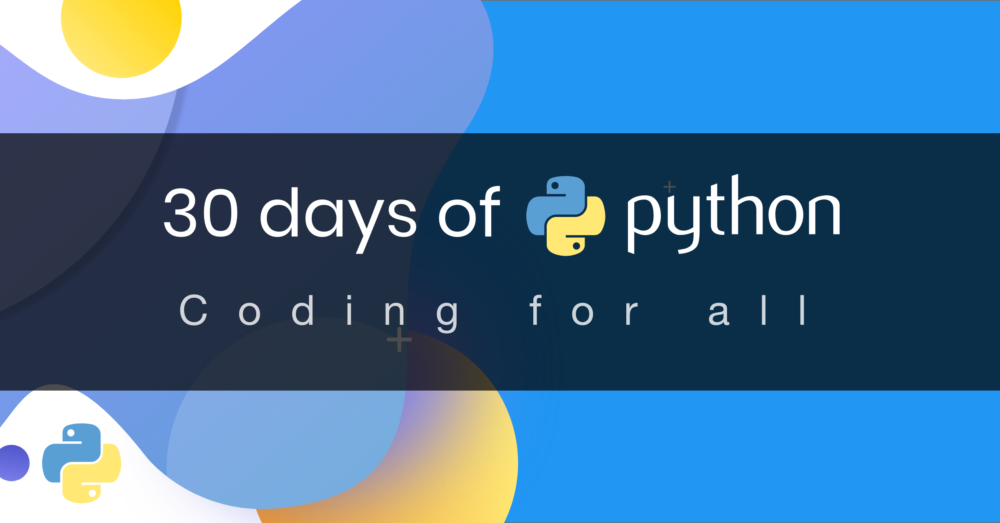

<div align="center">
  <h1> 30 Days Of Python: دن 1 - تعارف</h1>

  <sub>مصنف:
  <a href="#" target="_blank">محمد اسحاق (Muhammad Ishaq)</a><br>
  <small> اردو ترجمہ</small>
  </sub>
</div>

[اليوم التالي (Day 2) >>](./02_variables_builtin_functions.md)



## خوش آمدید
**مبارک ہو** کہ آپ نے *30 دن پائتھون (Python)* پروگرامنگ چیلنج میں حصہ لینے کا فیصلہ کیا ہے۔ اس چیلنج میں، آپ پائتھون پروگرامر بننے کے لیے درکار ہر چیز اور پروگرامنگ کا پورا تصور سیکھیں گے۔

## تعارف
پائتھون ایک ہائی لیول پروگرامنگ لینگویج ہے جو عام مقصد کی پروگرامنگ کے لیے استعمال ہوتی ہے۔ یہ ایک اوپن سورس، انٹرپریٹڈ، آبجیکٹ اورینٹڈ پروگرامنگ لینگویج ہے۔ یہ 30 دن کا پائتھون چیلنج آپ کو پائتھون کے تازہ ترین ورژن، پائتھون 3، کو قدم بہ قدم سیکھنے میں مدد کرے گا۔

## پائتھون کیوں؟
یہ ایک ایسی پروگرامنگ لینگویج ہے جو انسانی زبان کے بہت قریب ہے اور اس وجہ سے، اسے سیکھنا اور استعمال کرنا آسان ہے۔ پائتھون مختلف صنعتوں اور کمپنیوں کے ذریعہ استعمال ہوتی ہے۔

## ماحول کی ترتیب (Environment Setup)
### پائتھون انسٹال کرنا
پائتھون اسکرپٹ چلانے کے لیے آپ کو پائتھون انسٹال کرنے کی ضرورت ہے۔ آئیے [ڈاؤن لوڈ](https://www.python.org/) کریں۔

```shell
python3 --version
```

## بنیادی پائتھون
### پائتھون نحو (Syntax)
پائتھون اسکرپٹ پائتھون انٹرایکٹو شیل میں یا کوڈ ایڈیٹر میں لکھی جا سکتی ہے۔ پائتھون فائل کی ایکسٹینشن `.py` ہوتی ہے۔

### تبصرے (Comments)
تبصرے کوڈ کی پڑھنے کی صلاحیت کو بڑھانے اور ڈویلپرز کو اپنے کوڈ میں نوٹس چھوڑنے کی اجازت دینے میں اہم کردار ادا کرتے ہیں۔ پائتھون میں، ہیش (#) علامت سے پہلے کوئی بھی متن ایک تبصرہ سمجھا جاتا ہے اور کوڈ چلنے پر اس پر عمل نہیں ہوتا۔

## 💻 مشقیں - دن 1

### مشق: لیول 1
1. پائتھون کا ورژن چیک کریں جو آپ استعمال کر رہے ہیں۔
2. پائتھون انٹرایکٹو شیل کھولیں اور درج ذیل آپریشنز کریں۔
   - جمع (+)
   - تفریق (-)
   - ضرب (*)
   - تقسیم (/)

[Day 2 >>](./02_variables_builtin_functions.md)
