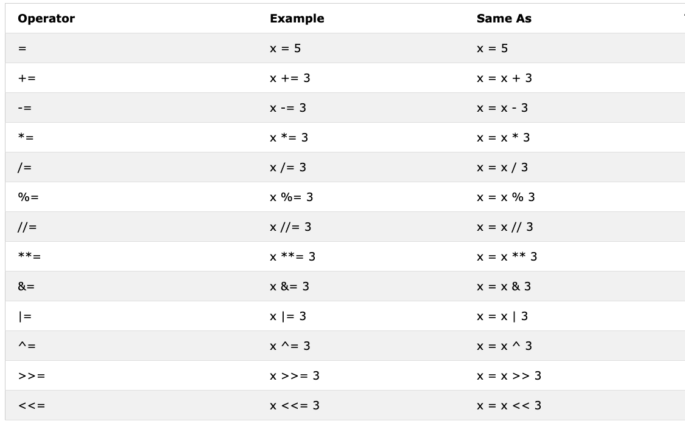
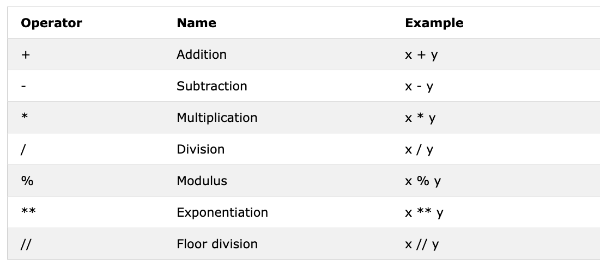

<div align="center">
  <h1> 30 Days Of Python: دن 3 - آپریٹرز</h1>
  <a class="header-badge" target="_blank" href="https://www.linkedin.com/in/asabeneh/">
  
  </a>
  <a class="header-badge" target="_blank" href="https://twitter.com/Asabeneh">
  
  </a>

  <sub>ترجمہ و ترتیب:
  <a href="https://github.com/MuhammadIshaqDev" target="_blank">محمد اسحاق (Muhammad Ishaq)</a><br>
  <small> دوسرا ایڈیشن: جولائی، 2021 | اردو ترجمہ</small>
  </sub>
</div>

[<< دن 2](../02_variables_builtin_functions.md) | [دن 4 >>](./04_strings.md)


- [📘 دن 3](#-دن-3)
  - [بولین (Boolean)](#بولین-boolean)
  - [آپریٹرز (Operators)](#آپریٹرز-operators)
    - [اسائنمنٹ آپریٹرز (Assignment Operators)](#اسائنمنٹ-آپریٹرز-assignment-operators)
    - [ریاضی کے آپریٹرز (Arithmetic Operators)](#ریاضی-کے-آپریٹرز-arithmetic-operators)
    - [موازنہ کے آپریٹرز (Comparison Operators)](#موازنہ-کے-آپریٹرز-comparison-operators)
    - [منطقی آپریٹرز (Logical Operators)](#منطقی-آپریٹرز-logical-operators)
  - [💻 مشقیں - دن 3](#-مشقیں---دن-3)

# 📘 دن 3

## بولین (Boolean)

بولین ڈیٹا کی قسم دو اقدار میں سے ایک کی نمائندگی کرتی ہے: _True_ یا _False_۔ ان ڈیٹا اقسام کا استعمال تب واضح ہوگا جب ہم موازنہ آپریٹر (comparison operator) کا استعمال شروع کریں گے۔ True کے لیے پہلا حرف **T** اور False کے لیے **F** بڑا (capital) ہونا چاہیے، جاوا اسکرپٹ (JavaScript) کے برعکس۔

**مثال: بولین اقدار**

```py
print(True)
print(False)
```

## آپریٹرز (Operators)

پائتھون لینگویج کئی قسم کے آپریٹرز کو سپورٹ کرتی ہے۔ اس سیکشن میں، ہم ان میں سے کچھ پر توجہ مرکوز کریں گے۔

### اسائنمنٹ آپریٹرز (Assignment Operators)

اسائنمنٹ آپریٹرز متغیرات (variables) کو اقدار تفویض کرنے کے لیے استعمال ہوتے ہیں۔ آئیے = کو بطور مثال لیتے ہیں۔ ریاضی میں برابر کا نشان ظاہر کرتا ہے کہ دو اقدار برابر ہیں، تاہم پائتھون میں اس کا مطلب ہے کہ ہم ایک خاص متغیر میں ایک قدر ذخیرہ کر رہے ہیں اور ہم اسے اسائنمنٹ یا متغیر کو قدر تفویض کرنا کہتے ہیں۔ نیچے دی گئی جدول پائتھون کے مختلف قسم کے اسائنمنٹ آپریٹرز کو دکھاتی ہے، جو [w3school](https://www.w3schools.com/python/python_operators.asp) سے لی گئی ہے۔



### ریاضی کے آپریٹرز (Arithmetic Operators)

- جمع (+): a + b
- تفریق (-): a - b
- ضرب (*): a * b
- تقسیم (/): a / b
- ماڈیولس (%): a % b
- فلور تقسیم (//): a // b
- ایکسپوننٹیشن (**): a ** b



**مثال: انٹیجرز (Integers)**

```py
# پائتھون میں ریاضی کے آپریشنز
# انٹیجرز

print('جمع: ', 1 + 2)        # 3
print('تفریق: ', 2 - 1)     # 1
print('ضرب: ', 2 * 3)  # 6
print ('تقسیم: ', 4 / 2)       # 2.0  پائتھون میں تقسیم فلوٹنگ نمبر دیتی ہے
print('تقسیم: ', 6 / 2)        # 3.0         
print('تقسیم: ', 7 / 2)        # 3.5
print('باقی کے بغیر تقسیم: ', 7 // 2)   # 3، فلوٹنگ نمبر کے بغیر یا باقی کے بغیر دیتا ہے
print ('باقی کے بغیر تقسیم: ',7 // 3)   # 2
print('ماڈیولس: ', 3 % 2)         # 1، باقی دیتا ہے
print('ایکسپوننٹیشن: ', 2 ** 3) # 8 اس کا مطلب 2 * 2 * 2 ہے
```

**مثال: فلوٹس (Floats)**

```py
# فلوٹنگ نمبرز
print('فلوٹنگ پوائنٹ نمبر، PI', 3.14)
print('فلوٹنگ پوائنٹ نمبر، کشش ثقل', 9.81)
```

**مثال: کمپلیکس نمبرز (Complex numbers)**

```py
# کمپلیکس نمبرز
print('کمپلیکس نمبر: ', 1 + 1j)
print('کمپلیکس نمبرز کی ضرب: ',(1 + 1j) * (1 - 1j))
```

آئیے ایک متغیر کا اعلان کریں اور ایک نمبر ڈیٹا ٹائپ تفویض کریں۔ میں ایک حرفی متغیر استعمال کر رہا ہوں لیکن یاد رکھیں کہ اس طرح کے متغیرات کا اعلان کرنے کی عادت نہ ڈالیں۔ متغیر کے نام ہر وقت یاد رکھنے والے (mnemonic) ہونے چاہئیں۔

**مثال:**
